<div align="center">

# Yusr — Smart Spiritual Guide for Pilgrims
### يُسر — المرشد الروحي الذكي للحجاج والمعتمرين

A bilingual (Arabic-first, English) Flutter mobile app that brings ritual guidance, an AI assistant, a Haram map, safety tools and a supplications library into one place for Hajj and Umrah pilgrims.


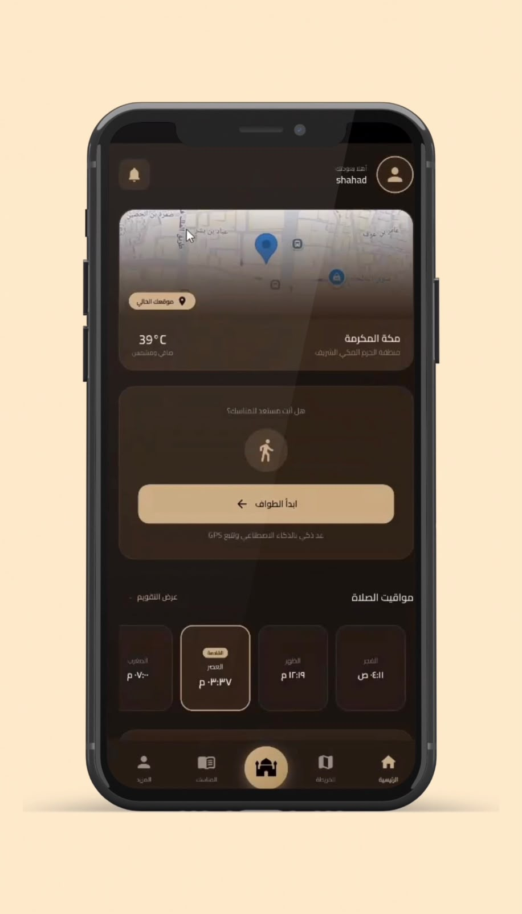 &nbsp;
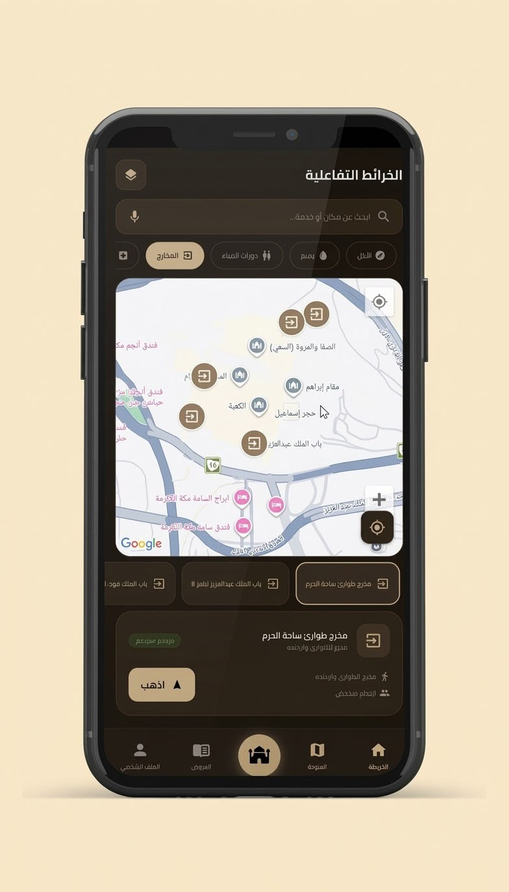 &nbsp;
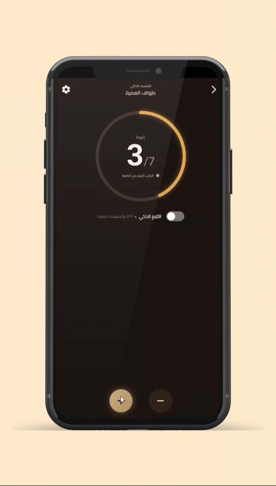

</div>

> **Academic project.** Yusr is a graduation capstone built by a **seven-member team** at the College of Computers and Information Technology, **Taif University**, during the 2025–2026 academic year. It is a prototype built for academic evaluation, not a production service, and it is not affiliated with any official Hajj or Umrah authority. See [Project structure and contributions](#project-structure-and-contributions).

---

## Table of contents

1. [Introduction](#introduction)
2. [Screenshots](#screenshots)
3. [Key features](#key-features)
4. [Technology stack](#technology-stack)
5. [Application architecture](#application-architecture)
6. [Screens and modules](#screens-and-modules)
7. [Getting started](#getting-started)
8. [Configuration and secrets](#configuration-and-secrets)
9. [Testing](#testing)
10. [Project structure and contributions](#project-structure-and-contributions)
11. [Known limitations and future improvements](#known-limitations-and-future-improvements)
12. [Acknowledgements and academic context](#acknowledgements-and-academic-context)
13. [License](#license)

---

## Introduction

Millions of people perform Hajj and Umrah each year. Many are visiting Makkah for the first time, may not speak Arabic, and have to follow a sequence of rituals inside very crowded areas. The project report describes a questionnaire of 34 respondents in which most reported difficulty orienting themselves inside the Haram and wanted a step-by-step digital guide and multilingual support.

Yusr tries to address this by combining, in one mobile app:

- an **AI assistant** scoped to Hajj and Umrah questions,
- a **map** of key Haram locations,
- **safety alerts and an SOS request flow** with an administrator view,
- a **Tawaf counter** with saved progress,
- a **searchable supplications (duas) library**,
- a **ritual guide**, **day-by-day journey checklist** and **prayer times**,
- an **administrator dashboard** for users, alerts, supplications and crowd levels.

**Intended users:** Hajj and Umrah pilgrims (pilgrim role) and operators who monitor and manage the service (administrator role).

> Yusr is a guidance aid. AI-generated answers are not religious rulings; pilgrims should consult qualified scholars or official authorities for religious or emergency matters.

---

## Screenshots

> Screenshots are taken from the build documented in the project report (Chapter 5.7). Personal data visible in the original captures (names and emails of test accounts) has been blurred. A few elements in those captures reflect functionality that is described in the report but differs from this repository snapshot — see [implementation status](#key-features) for what the source code in this repository actually contains.

### Pilgrim experience

| Home | AI chatbot | Interactive map | Safety alerts |
|:---:|:---:|:---:|:---:|
|  | 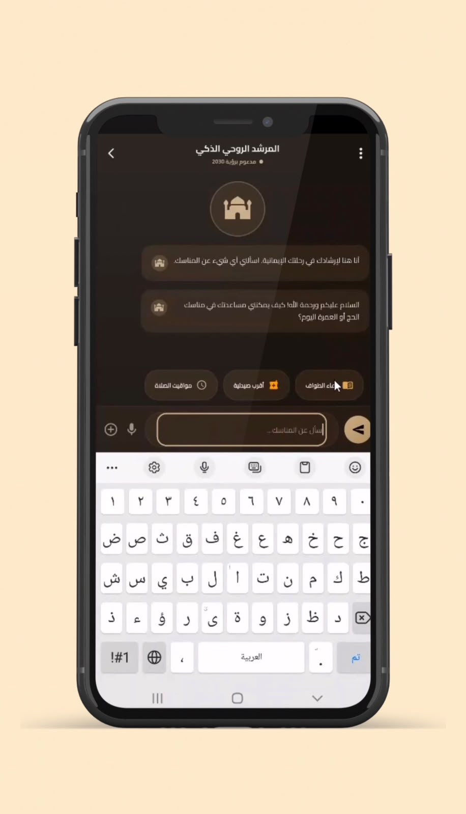 |  | 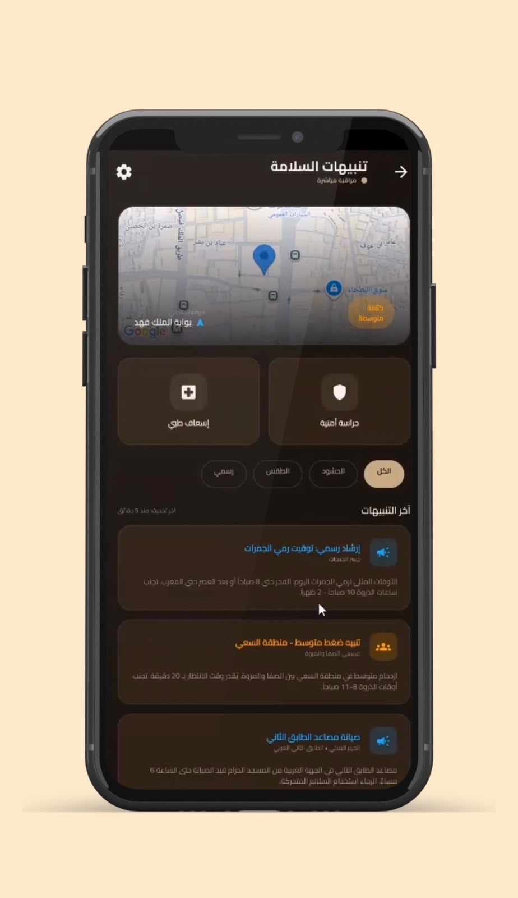 |

| SOS confirmation | Tawaf counter | Supplications library | Profile & settings |
|:---:|:---:|:---:|:---:|
| 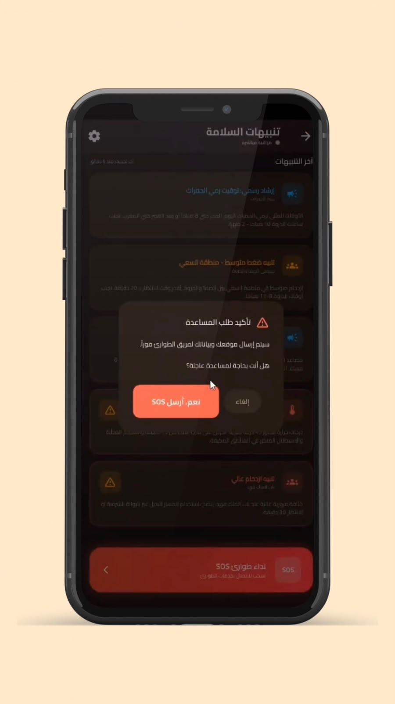 |  | 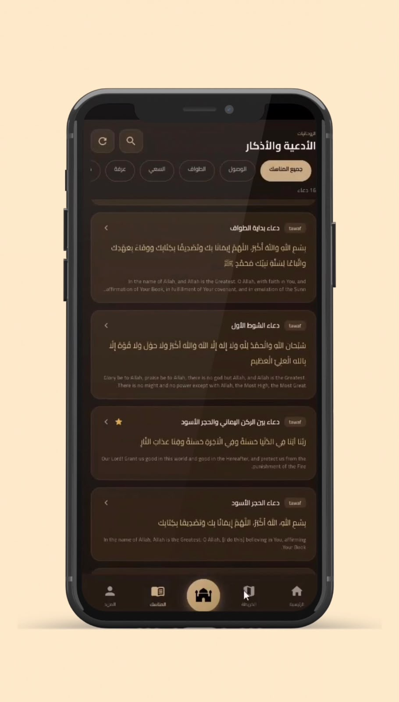 | 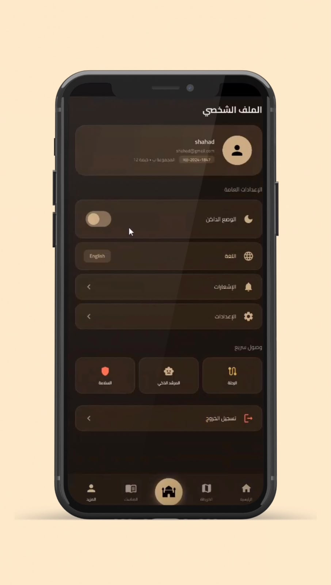 |

### Administrator

| Admin dashboard |
|:---:|
| 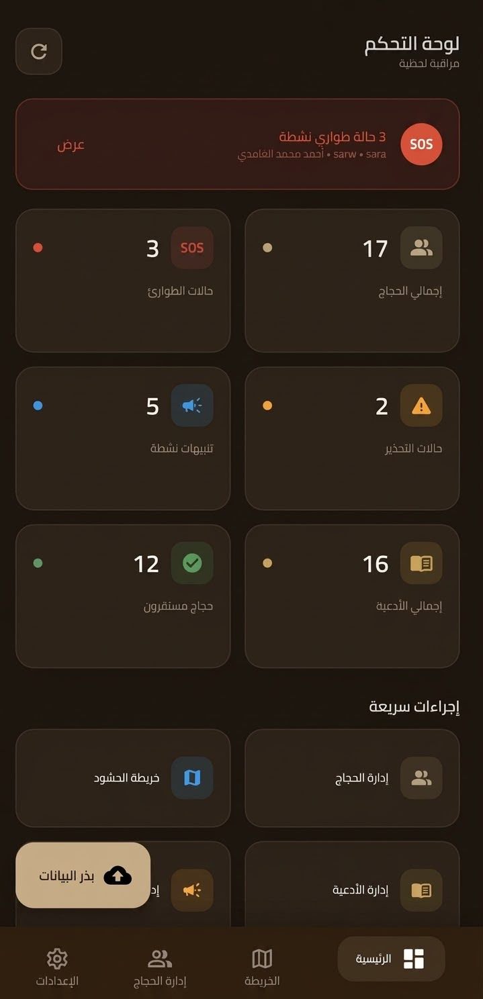 |


---

## Key features

Status legend: ✅ implemented in this repository's source · 🟡 partially implemented or limited · 📄 described in the project report but **not found** in this repository's source.

| Area | Status | What the code actually does |
|---|:---:|---|
| **Registration & authentication** | ✅ | Email/password sign-up and sign-in, password reset email, and Google Sign-In through Firebase Authentication. A Firestore profile document is created on sign-up. See [`auth_service.dart`](lib/core/services/auth_service.dart), [`auth_provider.dart`](lib/core/providers/auth_provider.dart). |
| Sign in with Apple | 📄 | Listed in the report's scope; no Apple sign-in code exists in the source. |
| **AI pilgrim guidance (Gemini)** | ✅ | Chat screen using `google_generative_ai` with model `gemini-3-flash-preview` and an Arabic system instruction that restricts answers to Hajj/Umrah topics. Three suggestion chips. Conversation lives only in memory for the current session. Scope control relies on the system prompt only. See [`ai_chat_screen.dart`](lib/features/ai_chat/ai_chat_screen.dart). |
| **Interactive Haram map** | 🟡 | Google Map centred on the Haram with eight predefined points of interest (Haram, Safa–Marwa walkway, Zamzam, Jamarat, Arafat, Muzdalifah, Mina, medical clinic), category filter chips, a crowd badge, and the device-location layer when permission is granted. The points and crowd levels are **hardcoded** in [`map_screen.dart`](lib/features/maps/map_screen.dart); they are not read from Firestore. Walking directions, Firestore-managed locations and an "admin map locations" screen described in the report were not found. |
| **Safety alerts & SOS** | 🟡 | Alerts list from the Firestore `alerts` collection with type filter chips. SOS flow: confirmation dialog → sets `users/{uid}.status = 'sos'` and creates a `sos_requests` document (name, contact, blood type, coordinates, timestamp); "I'm safe" cancels it. Admins see users in SOS status live on the dashboard and can change a user's status from the user-management screen; the `resolveSosRequest` helper in the service layer is not called from any admin screen. The coordinates sent come from the user's profile document; the `LocationTrackingService` that would keep them updated exists but is **not called anywhere** in this snapshot. The *Security* and *Ambulance* buttons have no tap handler (the report describes direct dialling; `url_launcher` is not a dependency). See [`safety_alerts_screen.dart`](lib/features/safety/safety_alerts_screen.dart). |
| **Digital Tawaf counter** | 🟡 | Seven-round counter with +/− buttons, a supporting dua, and progress saved to `users/{uid}/rituals` so it can be resumed. The screen is hardcoded to the Umrah Tawaf ritual type. A separate **Sa'i counter** (described in the report) is not implemented as its own screen; Sa'i items in the journey checklist open the same Tawaf counter. The "AI auto-tracking / GPS" label on this screen is static text. See [`tawaf_counter_screen.dart`](lib/features/counter/tawaf_counter_screen.dart). |
| **Supplications library** | ✅ | Loads duas from Firestore (`duas`), falls back to built-in defaults, category chips, search by Arabic/English title and Arabic text, favourites, copy-to-clipboard. 16 duas are provided by the seeder. The "listen" button is a placeholder (no audio). See [`supplications_screen.dart`](lib/features/supplications/supplications_screen.dart). |
| **Prayer times** | 🟡 | Times come from the public AlAdhan API for **Makkah** (Umm al-Qura method) and are shown on the home and journey screens. They are not computed from the device location, and no prayer notifications/reminders are implemented. A standalone `PrayerTimesScreen` exists but is not linked from navigation. |
| **Ritual guide** | ✅ | Step-by-step Umrah and Hajj guide (static content in [`rituals_guide_screen.dart`](lib/features/rituals/rituals_guide_screen.dart)). |
| **Journey** | 🟡 | A day-by-day **itinerary checklist** (prayers, rituals, travel, rest); completion state is stored in `users/{uid}/journey_progress`. This is **not** the free-text "journey notes" feature described in the report (no `JourneyNoteModel`, no note editing found). See [`journey_screen.dart`](lib/features/journey/journey_screen.dart). |
| **Profile & settings** | 🟡 | Profile card (name, email, Hajj ID, group), dark-mode and language switches, notification-settings screen, quick links, logout. The profile screen only **displays** data: no form for entering Hajj ID, blood type, phone or emergency contact was found, although the SOS request reads those fields. |
| **Arabic / English + RTL** | ✅ | `easy_localization` with `ar.json` / `en.json` (about 520 keys each; a handful of keys exist only in Arabic), Arabic default, runtime language switch, Cairo font. |
| **Light / dark theme** | ✅ | `ThemeProvider` persists the choice with `shared_preferences`; dark is the default. |
| **Admin dashboard** | ✅ | Role-gated (`role == 'admin'`, opened from the profile screen). Live statistics and SOS list, user list with ban/unban and role changes, alert create/toggle/delete, duas add/edit/delete, crowd-density updates with a map view, and a "seed data" action. See [`lib/features/admin/`](lib/features/admin). |
| Push notifications (FCM), Cloud Storage | 📄 | Mentioned in the report's scope and software table; the packages are not in `pubspec.yaml`. |

---

## Technology stack

| Technology | Verified in code | Purpose in this project |
|---|:---:|---|
| **Flutter / Dart** (SDK `^3.10.4`) | ✅ | Cross-platform UI and application logic. Android and iOS are the target platforms; desktop/web folders are default Flutter scaffolding. |
| **Firebase Authentication** (`firebase_auth`) | ✅ | Email/password and Google sign-in. |
| **Cloud Firestore** (`cloud_firestore`) | ✅ | Users, supplications, alerts, SOS requests, crowd data, announcements, ritual progress, journey progress. |
| **Google Gemini API** (`google_generative_ai`) | ✅ | AI chat assistant (`gemini-3-flash-preview`). |
| **Google Maps** (`google_maps_flutter`, `geolocator`, `permission_handler`) | ✅ | Haram map, device location layer, location permissions. |
| **Provider** | ✅ | State management (`AuthProvider`, `ThemeProvider`). |
| **Easy Localization** | ✅ | Arabic/English translations and RTL. |
| **Google Sign-In** (`google_sign_in` v7) | ✅ | Google authentication. |
| **AlAdhan API, Open-Meteo API** (`http`) | ✅ | Prayer times for Makkah; current temperature for Makkah on the home screen. |
| `shared_preferences` | ✅ | Persisting the theme choice. |
| `fl_chart`, `shimmer`, `percent_indicator`, `animated_text_kit`, etc. | declared | UI helper packages declared in `pubspec.yaml`. |
| `go_router` | declared, **unused** | Declared but navigation uses `Navigator`/`MaterialPageRoute`. |
| Git & GitHub | — | Version control and hosting for this repository. |

Not present in the source (despite appearing in the report): Firebase Cloud Messaging, Firebase Cloud Storage, `url_launcher`, Apple sign-in, Google Directions API.

---

## Application architecture

The project uses a **feature-first structure**: shared infrastructure lives in `lib/core/`, and each user-facing area lives in its own folder under `lib/features/`. Services talk to Firebase/HTTP APIs; screens read state through `Provider` or call services directly.

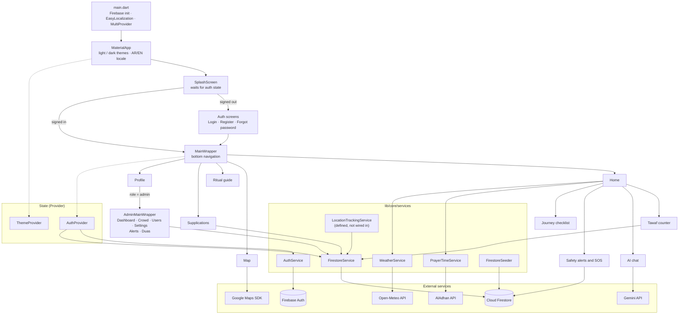

### Folder structure

```text
lib/
├── main.dart                     # Entry point: Firebase, localization, providers, theme
├── firebase_options.dart         # Generated by FlutterFire CLI (see "Configuration")
├── core/
│   ├── constants/                # AppColors, AppAssets
│   ├── models/                   # UserModel, DuaModel, RitualProgressModel
│   ├── providers/                # AuthProvider, ThemeProvider
│   ├── services/                 # Auth, Firestore, prayer times, weather, location, seeder
│   └── theme/                    # Light and dark ThemeData
└── features/
    ├── splash/  onboarding/  auth/  main_wrapper/
    ├── home/  rituals/  journey/  prayer_times/
    ├── ai_chat/  maps/  safety/  counter/  supplications/
    ├── profile/
    └── admin/                    # Dashboard, users, alerts, duas, crowd, settings
assets/
├── translations/                 # ar.json, en.json
├── fonts/                        # Cairo
└── images/                       # Logo
```

### Firestore data model (as used by the code)

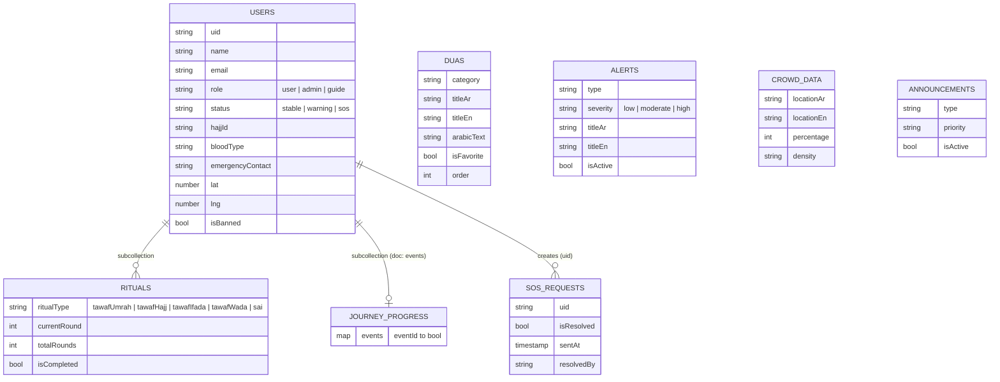

Notes on the data model:

- `ritual_guides` and `prayer_config` are written by the seeder but are never read by the app.
- A user's favourite duas are tracked both as an `isFavorite` flag on the shared `duas` document and through helper methods for a per-user list; the shared flag means favourites are not truly per-user.
- Firestore security rules are **not included** in this repository (see [Configuration](#configuration-and-secrets)).

---

## Screens and modules

| Module | Main source | Notes |
|---|---|---|
| App shell & navigation | [`main_wrapper.dart`](lib/features/main_wrapper/main_wrapper.dart) | Bottom bar: Home, Map, centre button to ritual guide, Supplications, Profile. |
| Splash & routing | [`splash_screen.dart`](lib/features/splash/splash_screen.dart) | Waits for Firebase auth state, then opens Login or the app shell. |
| Authentication | [`lib/features/auth/`](lib/features/auth) | Login, register, forgot password. Logic in `AuthProvider` / `AuthService`. |
| Home | [`home_screen.dart`](lib/features/home/home_screen.dart) | Makkah temperature, prayer times, entry points to Tawaf counter, AI chat, safety and journey. |
| AI chat | [`ai_chat_screen.dart`](lib/features/ai_chat/ai_chat_screen.dart) | Gemini chat session with Hajj/Umrah system instruction. |
| Map | [`map_screen.dart`](lib/features/maps/map_screen.dart) | Google Map, filter chips, location cards. |
| Safety & SOS | [`safety_alerts_screen.dart`](lib/features/safety/safety_alerts_screen.dart) | Alert stream, SOS create/cancel. |
| Tawaf counter | [`tawaf_counter_screen.dart`](lib/features/counter/tawaf_counter_screen.dart) | Persistent 7-round counter. |
| Supplications | [`supplications_screen.dart`](lib/features/supplications/supplications_screen.dart) | Search, categories, favourites. |
| Ritual guide | [`rituals_guide_screen.dart`](lib/features/rituals/rituals_guide_screen.dart) | Static Umrah/Hajj steps. |
| Journey | [`journey_screen.dart`](lib/features/journey/journey_screen.dart) | Itinerary checklist with saved completion state. |
| Prayer times | [`prayer_times_screen.dart`](lib/features/prayer_times/prayer_times_screen.dart) | Implemented but currently not linked from navigation. |
| Profile & settings | [`profile_screen.dart`](lib/features/profile/profile_screen.dart), [`settings_screen.dart`](lib/features/profile/settings_screen.dart) | Profile data, theme, language, admin entry for admins. |
| Onboarding | [`onboarding_screen.dart`](lib/features/onboarding/onboarding_screen.dart) | Implemented but currently not linked from navigation. |
| Admin | [`lib/features/admin/`](lib/features/admin) | Dashboard, users, alerts, duas, crowd, settings. |
| Data layer | [`firestore_service.dart`](lib/core/services/firestore_service.dart), [`firestore_seeder.dart`](lib/core/services/firestore_seeder.dart) | All Firestore access; demo data seeding. |

---

## Getting started

### Prerequisites

- **Flutter** stable with **Dart ≥ 3.10.4** (`pubspec.yaml` requires `sdk: ^3.10.4`; run `flutter --version` to confirm — this corresponds to a recent Flutter 3.38+ stable release).
- Android Studio (Android SDK) and/or Xcode + CocoaPods (iOS, macOS only).
- A **Firebase project** you control.
- A **Google Cloud project** with the *Maps SDK for Android* and/or *Maps SDK for iOS* enabled and a Maps API key.
- A **Gemini API key** from [Google AI Studio](https://aistudio.google.com/).
- Node.js and the Firebase CLI are only needed for `flutterfire configure` (`npm i -g firebase-tools`).

### 1. Clone and install

```bash
git clone https://github.com/<your-username>/yusr.git
cd yusr
flutter pub get
```

### 2. Connect your own Firebase project

The repository intentionally does **not** ship the team's Firebase configuration. Generate your own:

```bash
dart pub global activate flutterfire_cli
flutterfire configure
```

This creates `lib/firebase_options.dart` and (for Android) `android/app/google-services.json`. Both are git-ignored.

In the Firebase console:

1. **Authentication → Sign-in method:** enable **Email/Password** and **Google**.
2. **Firestore Database:** create a database and deploy security rules before inviting real users (see [Configuration](#configuration-and-secrets)).
3. **Android + Google Sign-In:** add your debug/release **SHA-1** fingerprints to the Android app, then re-download `google-services.json`.
4. **iOS + Google Sign-In:** the supplied `Info.plist` has no Google URL scheme; add your `REVERSED_CLIENT_ID` as a URL type if you target iOS. *(iOS Google Sign-In has not been verified for this snapshot.)*

### 3. Add Google Maps and Gemini keys

See [Configuration and secrets](#configuration-and-secrets) — in this snapshot the keys are placed directly in three files.

### 4. Run

```bash
flutter run                 # picks the connected device/emulator
flutter run -d <device-id>  # pick a specific device
```

### 5. Create the first administrator

There is no public path to become an admin:

1. Register a normal account in the app.
2. In the Firebase console open **Firestore → `users` → *your uid*** and change `role` from `user` to `admin`.
3. Log in again; an admin entry appears on the profile screen.
4. In the admin dashboard, the **seed data** action fills `duas`, `alerts`, `crowd_data`, `announcements` and some *test users*. Use it only on a development project, never on a production one.

### Platform notes

- **Android:** package name is still the placeholder `com.example.morshedy`; change it (and register the new ID in Firebase) before any release. Release builds are currently signed with the **debug** key — add your own signing config. Permissions: internet, fine/coarse location.
- **iOS:** requires your Maps key in `AppDelegate.swift` and a Firebase iOS app whose bundle ID matches the project.
- **Web/Windows/macOS/Linux:** folders exist from the Flutter template and `firebase_options.dart` covers web, Windows and macOS, but only Android/iOS are the documented targets and the others have not been verified.
- **Network:** all main features need an internet connection; there is no offline mode.

---

## Configuration and secrets

The app depends on four kinds of configuration. **Never commit real values.** The `.gitignore` in this repository already excludes the files below.

| Value | Where it is used in this snapshot | What to provide |
|---|---|---|
| Firebase client config | `lib/firebase_options.dart`, `android/app/google-services.json` | Generate with `flutterfire configure` for **your** project. |
| Google Maps (Android) | `android/app/src/main/AndroidManifest.xml` → `com.google.android.geo.API_KEY` meta-data | Your Maps SDK for Android key. |
| Google Maps (iOS) | `ios/Runner/AppDelegate.swift` → `GMSServices.provideAPIKey(...)` | Your Maps SDK for iOS key. |
| Gemini API key | `lib/features/ai_chat/ai_chat_screen.dart` → `GenerativeModel(apiKey: ...)` | Your Gemini key. |

### Important: the original code hardcodes keys

In the snapshot this README was written against, the Maps keys and the Gemini key are **string literals in source files**. Before publishing or forking:

1. Remove the literals and replace them with placeholders (below).
2. **Rotate/revoke** any key that was ever shared, committed, zipped or posted (Gemini and Maps keys especially — a leaked Gemini key can be abused on your billing quota).
3. Restrict keys in Google Cloud: Maps keys by **Android package + SHA-1** / **iOS bundle ID** and by API; Firebase API keys by app and API.
4. Remember that **any key shipped inside a mobile app can be extracted** from the binary. Restricting and moving keys out of Git keeps them out of your repository, but it does not make them secret on a user's device. For Gemini in particular, consider calling the model through a backend you control or through Firebase AI Logic with App Check instead of embedding a raw key.

### Suggested approach (not yet applied in the code)

**Gemini key via `--dart-define`**

```dart
// lib/core/config/api_keys.dart
class ApiKeys {
  static const gemini = String.fromEnvironment('GEMINI_API_KEY');
}
// then: GenerativeModel(model: 'gemini-3-flash-preview', apiKey: ApiKeys.gemini, ...)
```

```bash
# dart_defines.json is git-ignored; keep a dart_defines.example.json with empty values
flutter run --dart-define-from-file=dart_defines.json
```

```json
{ "GEMINI_API_KEY": "YOUR_GEMINI_KEY" }
```

**Android Maps key via `local.properties`** (already git-ignored)

```properties
# android/local.properties
MAPS_API_KEY=YOUR_ANDROID_MAPS_KEY
```

```kotlin
// android/app/build.gradle.kts → defaultConfig
val localProps = java.util.Properties().apply {
    rootProject.file("local.properties").takeIf { it.exists() }?.inputStream()?.use { load(it) }
}
manifestPlaceholders["MAPS_API_KEY"] = localProps.getProperty("MAPS_API_KEY", "")
```

```xml
<!-- AndroidManifest.xml -->
<meta-data android:name="com.google.android.geo.API_KEY" android:value="${MAPS_API_KEY}" />
```

**iOS Maps key via an ignored `.xcconfig`** — define `MAPS_API_KEY` in an untracked `Secrets.xcconfig` included from `Debug.xcconfig`/`Release.xcconfig`, expose it in `Info.plist` as `$(MAPS_API_KEY)`, and read it in `AppDelegate.swift` with `Bundle.main.object(forInfoDictionaryKey: "MAPS_API_KEY")`.

No `.env` file is used by the app today, so none is provided; add a template only if you adopt one of the mechanisms above.

### Firestore security rules

Role checks in the UI (`isAdmin`) are not a security boundary. Because the admin screens write directly to Firestore from the client, **server-side Firestore Security Rules must restrict admin-only collections to users whose `role` is `admin`**, and must stop users from editing their own `role`, `isBanned` or `status` fields beyond what the app needs. The project report (Chapter 7.3.4) outlines a rule set; no `firestore.rules` file is present in this repository, and the sample in the report does not by itself prevent a user from changing their own `role`. Review and test rules before using real data.

---

## Testing

### What can be run from this repository

- `flutter analyze` — static analysis with `flutter_lints` (configured in `analysis_options.yaml`).
- `flutter test` — the only Dart test is [`test/widget_test.dart`](test/widget_test.dart), which is the **unmodified Flutter template** (it expects a counter app with a "+" button and does not initialise Firebase). It does not test Yusr and is expected to fail as written. The `ios/RunnerTests` and `macos/RunnerTests` files are likewise empty template stubs.

There is therefore **no meaningful automated test suite** in this repository yet.

### What the academic report documents (manual, not reproducible from the repo)

Chapter 6 of the project report describes three manual test layers carried out by the team on physical Android and iOS devices:

| Layer | What the report states |
|---|---|
| Functional testing | 29 documented test cases (TC-01 … TC-29) across authentication, AI chat, map, safety/SOS, Tawaf counter, supplications and admin modules, all recorded as *Pass*. |
| User acceptance testing | 8 scenarios with 8 testers; reported overall task completion of 96.9%. |
| Performance testing | 8 timing benchmarks (for example AI first response, map load, SOS write, language switch), all recorded as meeting their targets. |

These results come from the report; the test devices, accounts, backend data and measurement tooling are not part of this repository, so they cannot be re-run from it. Some tested features (Sa'i counter, journey notes, admin map locations, directions) are described in the report but were not found in this source snapshot, so the report's results may refer to a different or later build.

### Suggested next steps

Unit tests for `UserModel` / `DuaModel` / `RitualProgressModel` (`fromMap`/`toMap`), widget tests with a faked Firestore (for example `fake_cloud_firestore`), and tests for the SOS and Tawaf persistence logic.

---

## Project structure and contributions

Yusr is a **seven-member academic team project**. The report describes an Agile Scrum process over eight sprints across two semesters, with all seven members mapped to the development team role. The application, report and design decisions are the result of that team effort; no single person built the whole system.

### My contributions


Within the team, my responsibilities were:

- **Database design and data modelling** — the Firestore structure for users, supplications, alerts, SOS requests, crowd data and ritual progress (see the data model above and the ER diagram in the report, Chapter 3.7).
- **Front-end screens** — Flutter user-interface screens for the app.
- **UX flow** — how users move between screens such as onboarding/authentication, home, ritual tools and safety features.

Other team members worked on the remaining parts of the system and the report; please refer to the acknowledgements for the full team.

---

## Known limitations and future improvements

### Limitations documented in the report

- Requires an active internet connection; **no offline mode** (maps, AI chat and Firestore data all depend on connectivity).
- AI chat context resets on cold start (no cross-session memory).
- Map directions are not shown when offline or on poor connectivity.
- Google Sign-In does not work on devices without Google Play Services.
- Excluded from scope: IoT hardware, a pilgrim web app, integration with official Ministry systems, payments/permits.

### Limitations observed in this repository snapshot

- API keys are hardcoded (see [Configuration](#configuration-and-secrets)); the Gemini model name is a *preview* model that may change.
- Map points of interest and crowd levels shown to pilgrims are static; the admin "crowd" screen writes to Firestore but the map screen does not read it.
- Live location tracking is not wired in, so SOS coordinates may be missing or stale, and there is no in-app way to enter the emergency contact or blood type that SOS requests include (they exist only if set in Firestore by an admin or the seeder).
- Security/Ambulance quick-dial buttons, the dua "listen" button, prayer notifications and a dedicated Sa'i counter are not implemented.
- The user-facing alert list appears to use the admin stream (`streamAlerts`) without an `isActive` filter, so deactivated alerts may still be displayed. *(Observed from the code; not run.)*
- Prayer times are fixed to Makkah rather than the device location.
- `PrayerTimesScreen`, `OnboardingScreen` and `go_router` are present but unused.
- No automated tests; no Firestore rules file; release signing uses the debug key; placeholder package name `com.example.morshedy`.

### Future work proposed in the report (not implemented)

Offline mode with cached maps and local storage of duas, augmented-reality navigation, wearable (Wear OS / Apple Watch) integration, group and family tracking with geofencing, additional languages (Urdu, Indonesian, Turkish, French, Bengali), cross-session AI memory, and integration with official Hajj systems.

---

## Acknowledgements and academic context

Yusr was developed as a graduation project for the Bachelor of Information Technology at the **College of Computers and Information Technology, Taif University, Saudi Arabia** (2025–2026), under the supervision of **Dr. Mona Alnahari**.


Thanks also to the 34 questionnaire participants and the testers mentioned in the report. The Cairo typeface is used under its own open font license; Google Maps, Firebase and Gemini are products of their respective owners. The report states that the work is the property of Taif University under its intellectual-property rules — check university policy before choosing a public license.

---

## License

**This project was developed as a university graduation project at Taif University. No open-source license has been applied. Please contact the relevant rights holders for permission before copying, modifying, or redistributing the project.**
